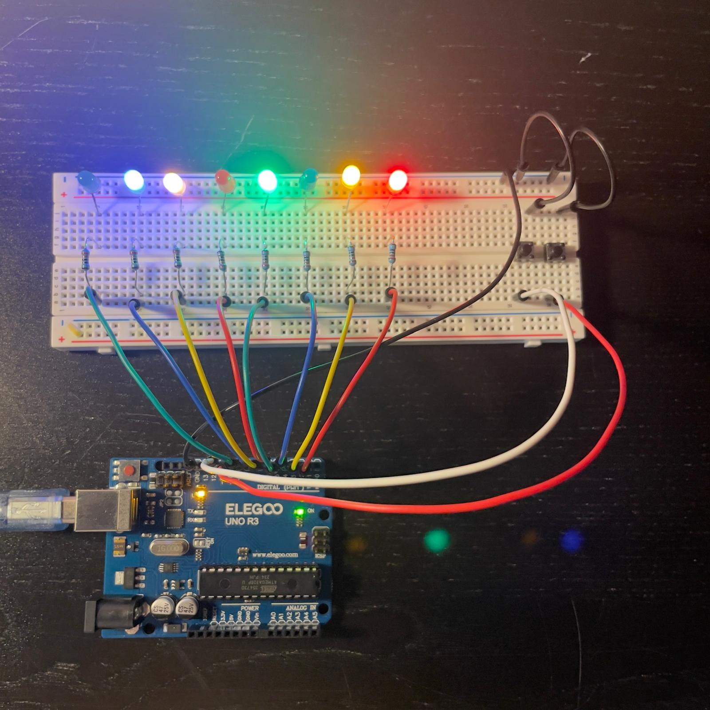
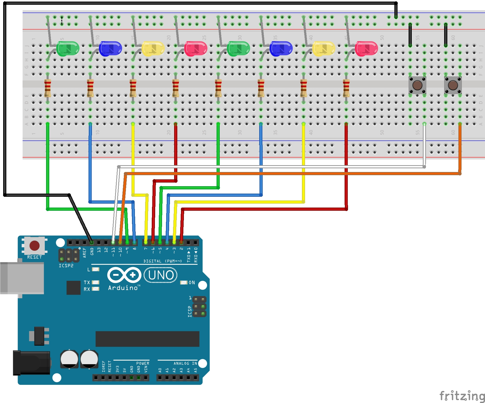
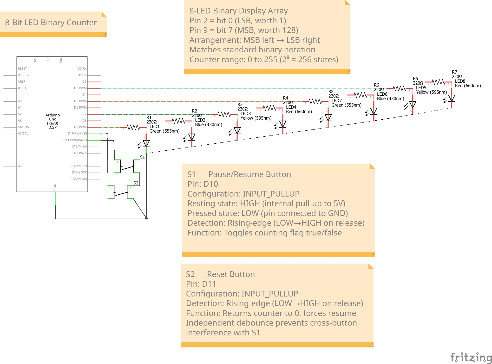

# 8-Bit LED Binary Counter

An Arduino project that displays numbers from **0 to 255** using eight LEDs. Each LED represents one bit: **ON = 1**, **OFF = 0**. Two buttons pause/resume counting and reset the display to zero.

This is Project 1 in my Arduino portfolio, building toward an automated aquarium controller.



## Features

- Updates every 500 ms and wraps from 255 to 0.
- Pause/resume toggles when the pause button is released.
- Reset returns the display to 0 and resumes counting, including when paused.
- Each button has an independent 200 ms event lockout to suppress repeated release events.
- Decimal and eight-digit binary values are printed to the Serial Monitor at 9600 baud.

## Components

| Component | Quantity |
|---|---:|
| ELEGOO UNO R3 / Arduino UNO-compatible board | 1 |
| LEDs — green, blue, yellow, red | 8 total, 2 of each color |
| 220 Ω series resistors | 8 |
| Momentary push buttons | 2 |
| Breadboard | 1 |
| Jumper wires | As needed |
| USB cable | 1 |

## Wiring

Viewed from the front, the LEDs run from the most significant bit (MSB) on the left to the least significant bit (LSB) on the right.

| Arduino pin | Function | Bit weight |
|---|---|---:|
| D9 | Leftmost LED — bit 7 (MSB) | 128 |
| D8 | LED — bit 6 | 64 |
| D7 | LED — bit 5 | 32 |
| D6 | LED — bit 4 | 16 |
| D5 | LED — bit 3 | 8 |
| D4 | LED — bit 2 | 4 |
| D3 | LED — bit 1 | 2 |
| D2 | Rightmost LED — bit 0 (LSB) | 1 |
| D10 | Pause/resume button | — |
| D11 | Reset button | — |
| GND | Common LED cathode and button ground | — |

Connect each LED output through its own 220 Ω resistor to the LED anode. Connect each cathode to GND. Each button connects its input pin to GND when pressed. With `INPUT_PULLUP`, the input reads HIGH at rest and LOW when pressed. Actions occur on a LOW-to-HIGH transition, normally on release.

### Breadboard diagram



### Schematic



**Schematic correction:** The drawn S1/S2 connections are swapped relative to the annotations. Follow the code and pin table: **S1 (pause/resume) connects to D10; S2 (reset) connects to D11.**

## Binary display

Eight bits provide 2⁸ = 256 possible values, from `00000000` (0) to `11111111` (255). The weights from left to right are:

```text
Bit:       7   6   5   4   3   2   1   0
Weight:  128  64  32  16   8   4   2   1
```

Decimal **13** is `00001101`: 8 + 4 + 1. The LEDs on D5, D4, and D2 light up.

The expression `(val >> i) & 1` extracts bit `i`. Right shift moves it into the lowest position, and AND with 1 keeps only that bit. `digitalWrite()` sends the result to the matching LED.

## Running the project

1. Assemble the circuit using the pin table and breadboard diagram.
2. Create an Arduino sketch named `Binary_Counter` and paste in the code below.
3. Select the board and connected serial port, then upload.
4. Open the Serial Monitor at **9600 baud**.
5. Release the pause button to pause/resume. Release reset to return to zero and resume counting.

No additional libraries are required.

## Button handling and timing limitations

Mechanical contacts can bounce and produce several transitions from one physical action. Each accepted release event starts a separate 200 ms lockout for that button. This suppresses repeated events but does not verify that the input stayed stable for 200 ms. Release detection alone does not eliminate bounce.

While counting, `delay(500)` blocks button checks. A quick press and release entirely within that delay can be missed. While paused, buttons are checked continuously.

A future improvement is to replace the delay with a `millis()` counting timer and accept button changes only after a stable input period.

## Debugging lessons

The project report describes these development problems:

| Problem | Cause | Fix |
|---|---|---|
| One LED did not light | Cathode was not fully seated | Reseated the LED leg |
| Button input stayed LOW | Wires used the same internally connected pair of legs | Rewired across the switched contacts |
| Pause worked only while held | Code followed the live button state | Added a stored control flag |
| Multiple toggles on release | Repeated release transitions | Increased the event lockout from 50 ms to 200 ms |

Testing LEDs individually and printing button states helped isolate wiring faults before integrating the complete program.

## Photos, videos, and report

- [Earlier build — LEDs only](Project1_LED_Binary_Counter_Image_1.jpeg)
- [Intermediate build — one button](Project1_LED_Binary_Counter_Image_2.jpeg)
- [Completed build — two buttons](Project1_LED_Binary_Counter_Image_3.jpeg)
- [Demo video 1](Project1_LED_Binary_Counter_Video_1.mp4)
- [Demo video 2](Project1_LED_Binary_Counter_Video_2.mp4)
- [Project report — R1 (Word)](Project1_LED_Binary_Counter_R1.docx)

## Hardware verification checklist

| Check | Expected behavior |
|---|---|
| Count 0 | All LEDs off |
| Count 13 | D2, D4, D5 LEDs on; others off |
| Count 255 | All LEDs on |
| Wraparound | Display changes from 255 to 0 |
| Pause | Display holds its current value |
| Resume | Counting continues |
| Reset while running or paused | Display returns to 0 and counting resumes |

## What I learned

This project connected binary numbers to a physical display and showed how software timing affects real inputs. It taught me to check wiring systematically, distinguish live inputs from stored control states, and recognize the limitations of simple button handling.

## Code

```cpp
const int ledPins[]  = {2,3,4,5,6,7,8,9};
const int pausePin   = 10;
const int resetPin   = 11;

int counter          = 0;
bool counting        = true;
unsigned long lastPauseDebounce = 0;
unsigned long lastResetDebounce = 0;
bool lastPauseState  = HIGH;
bool lastResetState  = HIGH;

void setup() {
  for(int i=0; i<8; i++) pinMode(ledPins[i], OUTPUT);
  pinMode(pausePin, INPUT_PULLUP);
  pinMode(resetPin, INPUT_PULLUP);
  Serial.begin(9600);
}

void displayBinary(int val) {
  for(int i=0; i<8; i++) {
    digitalWrite(ledPins[i], (val >> i) & 1);
  }
}

void loop() {
  // Pause button: rising edge (release)
  bool currentPauseState = digitalRead(pausePin);
  if(lastPauseState==LOW && currentPauseState==HIGH
     && millis()-lastPauseDebounce>200) {
    counting = !counting;
    lastPauseDebounce = millis();
  }
  lastPauseState = currentPauseState;

  // Reset button: rising edge (release)
  bool currentResetState = digitalRead(resetPin);
  if(lastResetState==LOW && currentResetState==HIGH
     && millis()-lastResetDebounce>200) {
    counter  = 0;
    counting = true;
    displayBinary(0);
    lastResetDebounce = millis();
    Serial.println("--- RESET ---");
  }
  lastResetState = currentResetState;

  // Counter
  if(counting) {
    displayBinary(counter);
    Serial.print("Decimal: "); Serial.print(counter);
    Serial.print("  Binary: ");
    for(int i=7; i>=0; i--) Serial.print((counter>>i)&1);
    Serial.println();
    counter = (counter+1) % 256;
    delay(500);
  }
}
```
